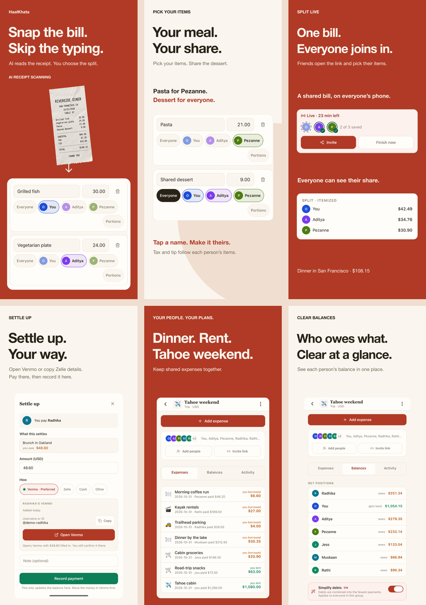
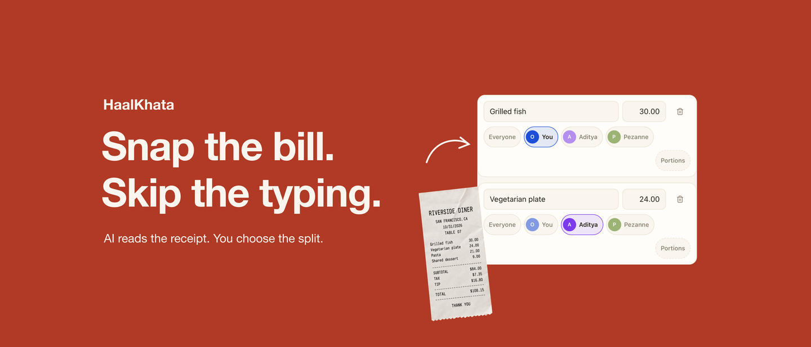

<!-- Index of release artwork, source captures, and submission records. -->

# App Store release assets

Version 1.0, build 1.0.0 (6), was submitted on October 31, 2026 at 4:13 PM PDT.
Apple reported **Waiting for Review**. Public release is manual. The dated record
is in [submission.json](1.0.0/submission.json); it is not a live status feed.

## Submitted assets

Paths below are relative to `1.0.0/`.

| Placement | Files | Dimensions |
| --- | --- | --- |
| iPhone, medium display | `creative-v3/iphone-medium/01-ai.png` through `06-balances.png` | 1206 x 2622 |
| iPad, 13-inch display | `creative-v3/ipad/01-ai.png` through `06-balances.png` | 2064 x 2752 |
| Product-page header | `creative-v3/creative-assets/header.png` | 3840 x 1646 |
| Search results | `creative-v3/creative-assets/search-results.png` | 3840 x 2560 |

The six-image sequence is AI scanning, item selection, live collaboration,
settlement, groups, and balances. The large iPhone set in `creative-v3/iphone/`
was exported at 1320 x 2868 but was not uploaded. Preview PNGs are contact sheets
or reduced artwork for inspection, not upload files.





The current listing is [metadata.json](1.0.0/metadata.json). The production EAS
submission profile points to `../store.config.cjs`, which reads that listing.
Private review contact phone data is supplied through `HAALKHATA_REVIEW_PHONE`
and is not stored here. Source checks and the App Store Connect submission link
are in the [submission audit](../../../docs/audits/app-store-submission-2026-10-31.md).

## Sources and design archive

`creative-v2/native/{iphone,ipad}/` contains native captures with fictional local
data used by the submitted compositions. The California receipt illustration is
also fictional. These images are marketing examples, not evidence of production
provider testing. Settlement examples depict paying in another app and recording
that payment in HaalKhata.

The full design history is retained: `screenshots/`, `artwork-options/`,
`copy-options.json`, the v2 compositions and research directions, and
`creative-v3/options/` are superseded or unselected concepts. Only the files in
the table above were submitted. Earlier renderers in `scripts/app-store/` are
historical design sources and may depend on earlier caption sets.

## Reproduce the submitted compositions

From the repository root, use Node 24 or later and install the locked workspace
dependencies with `pnpm install --frozen-lockfile`. The renderers use the web
workspace's Sharp dependency. macOS Helvetica Neue is used for the submitted
typography; other font installations may produce different text measurements.

Render into a separate directory to preserve the submitted PNGs and their
publication records:

```sh
node scripts/app-store/render-bold-screenshots.mjs /tmp/haalkhata-artwork-check/screenshots
node scripts/app-store/render-creative-assets.mjs /tmp/haalkhata-artwork-check/creative-assets
```

Both scripts accept an optional output directory. Without it, they write to the
versioned asset folders and regenerate their local copy or export manifest.
They perform no network requests or uploads. Inspect changed exports in Apple's
device preview before a future submission; `submission.json` remains the dated
record of what was submitted for this release.
